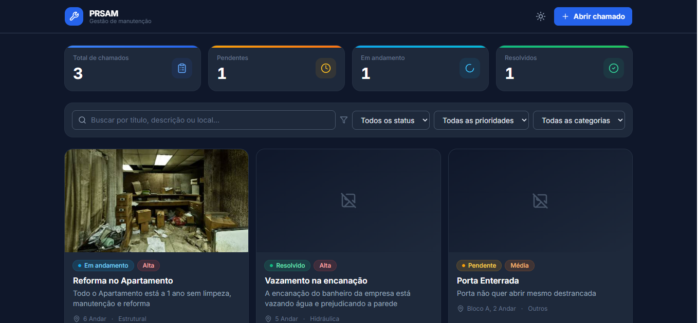
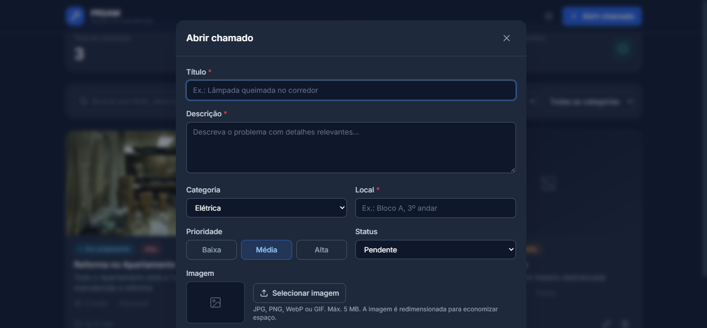

# PRSAM

**Plataforma de Registro e Solicitações de acompanhamento de Manutenção** para abrir, organizar e acompanhar chamados de manutenção em uma interface web.

## Sobre o projeto

Solicitações de manutenção podem ficar dispersas e ser difíceis de acompanhar. O PRSAM reúne os chamados em uma lista pesquisável, com informações de localização, categoria, prioridade, status e histórico para facilitar seu acompanhamento.

## Funcionalidades

- Criar, visualizar, editar e excluir chamados. A exclusão solicita confirmação.
- Registrar título, descrição, local, categoria, prioridade e status.
- Pesquisar chamados por título, descrição ou local e combinar a pesquisa com filtros de status, prioridade e categoria.
- Anexar uma imagem JPG, PNG, WebP ou GIF de até 5 MB. A imagem é redimensionada para uma miniatura e armazenada como JPEG.
- Consultar os detalhes do chamado, incluindo datas, imagem e histórico de criação e edição.
- Visualizar indicadores do total de chamados e das quantidades pendentes, em andamento e resolvidas.
- Alternar entre os temas claro e escuro. Na ausência de uma preferência salva, o tema inicial acompanha a preferência do sistema.
- Manter chamados e preferência de tema no armazenamento local do navegador.

## Capturas de tela

As capturas disponíveis no repositório:

### Visão geral



### Criação de chamado



## Tecnologias

| Tecnologia | Finalidade |
| --- | --- |
| React | Construção da interface baseada em componentes. |
| TypeScript | Tipagem dos chamados, estados e componentes. |
| Vite | Servidor de desenvolvimento e geração do build. |
| Tailwind CSS | Estilização utilitária e temas claro/escuro. |
| Lucide React | Ícones da interface. |
| Web Storage API (`localStorage`) | Persistência local dos chamados e da preferência de tema. |
| Vitest, JSDOM e Testing Library | Testes automatizados de lógica, armazenamento e componentes. |

## Arquitetura

A aplicação é uma SPA React inicializada em `src/main.tsx`. A interface principal em `src/App.tsx` coordena os chamados, a busca e os filtros, os indicadores, formulários, detalhes e confirmações.

- `src/components/`: componentes da interface, como formulário, cartões, detalhes, filtros, indicadores e notificações.
- `src/hooks/`: lógica de estado dos chamados (`useTickets`) e do tema (`useTheme`).
- `src/lib/`: funções de persistência, validação e processamento de imagens, filtros e formatação.
- `src/types.ts`: tipos e valores possíveis para chamados, status, prioridades e categorias.
- `src/assets/screenshots/`: capturas de tela do projeto.

Os dados ficam no navegador: `src/lib/storage.ts` lê e grava os chamados sob a chave `prsam.tickets` e o tema sob `prsam.theme`. Os chamados são validados na leitura. Se o conteúdo estiver inválido ou o navegador bloquear o acesso ao armazenamento, a aplicação informa o erro e evita sobrescrever os dados existentes.

## Pré-requisitos

- Node.js compatível com Vite 7: **20.19+** ou **22.12+**.
- npm.

## Instalação e execução

Na pasta `project`:

```bash
npm install
npm run dev
```

O Vite exibirá no terminal o endereço local para abrir a aplicação no navegador.

### Testes, validação e build

```bash
npm test
npm run typecheck
npm run lint
npm run build
```

O build de produção é gerado em `dist/`. Para servi-lo localmente após o build:

```bash
npm run preview
```

## Armazenamento e limitações

- Chamados e preferência de tema são persistidos somente no `localStorage` do navegador.
- Não há backend, banco de dados remoto, sincronização entre usuários ou compartilhamento automático entre dispositivos.
- Os dados ficam vinculados ao perfil e à origem do navegador. Limpar os dados do site ou perder acesso a esse perfil pode removê-los.
- O espaço disponível é limitado pelo navegador; imagens podem contribuir para atingir esse limite. Falhas de gravação são informadas pela interface.
- Se os dados dos chamados estiverem inválidos ou o armazenamento não puder ser lido, a aplicação não os substitui automaticamente; as operações sobre chamados ficam bloqueadas.
- As capturas de tela são imagens estáticas e não representam dados sincronizados.

## Possíveis melhorias futuras

- Adicionar uma API e armazenamento centralizado com autenticação e sincronização entre dispositivos.
- Oferecer exportação e importação de cópias de segurança dos chamados.
- Permitir configurar categorias, limites de imagem e campos de acordo com as necessidades da organização.
- Ampliar testes automatizados para fluxos de interface completos e acessibilidade.
